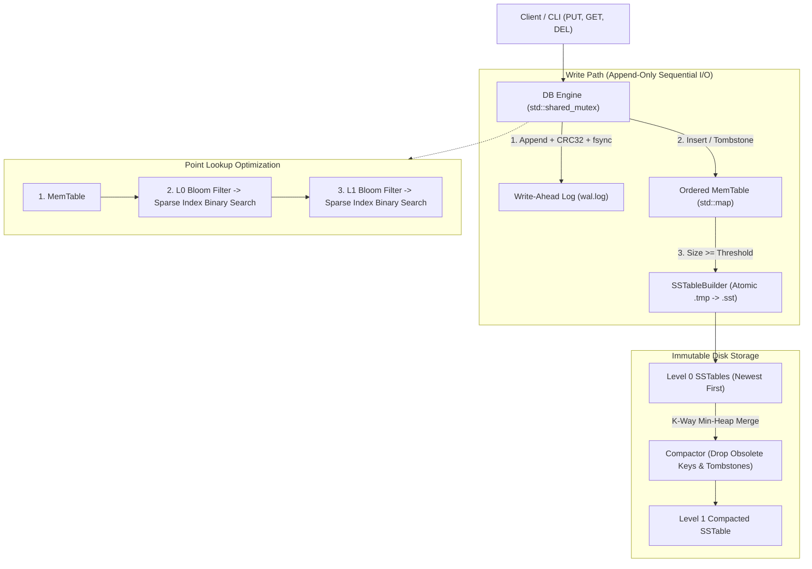

# KVForge LSM Engine

[](https://en.cppreference.com/w/cpp/17)
[](https://www.python.org/)
[](https://cmake.org/)
[](LICENSE)

**KVForge** is a crash-safe, embedded **Log-Structured Merge-Tree (LSM-Tree)** key-value storage engine implemented from scratch in **C++17**, accompanied by a zero-dependency **Python 3** binary inspection and workload benchmarking suite.

Built to explore write-optimized storage internals, durability guarantees, probabilistic read amplification reduction, and deterministic disk compaction.

---

## System Architecture



## Key Engineering Highlights

| Component                              | Design Choice & Rationale                                                                                                                                                                                                                                               |
| :------------------------------------- | :---------------------------------------------------------------------------------------------------------------------------------------------------------------------------------------------------------------------------------------------------------------------- |
| **Write-Ahead Log (`wal.cpp`)**        | Little-endian binary framing (`[CRC32][Op][KeyLen][ValLen][Key][Val]`) with IEEE 802.3 CRC32 verification and cross-platform `fsync` / `_commit`. Differentiates mid-file bit rot from crash-induced truncated tails and auto-truncates partial tail bytes on recovery. |
| **MemTable (`memtable.cpp`)**          | Ordered `std::map` maintaining sorted key order for $O(N)$ SSTable flushes with explicit deletion tombstones and byte-budget accounting.                                                                                                                                |
| **Bloom Filters (`bloom_filter.cpp`)** | Kirsch-Mitzenmacher double hashing (`FNV-1a + Murmur avalanche`) serialized directly inside each SSTable, eliminating unnecessary disk seeks on negative lookups (\~1% false positive rate at 10 bits/key).                                                             |
| **SSTables (`sstable.cpp`)**           | Immutable on-disk layout containing `[Data Blocks][Sparse Index][Bloom Filter][32-Byte CRC-Protected Footer]`. Lookups run $O(\log(N/k))$ binary search on the in-memory sparse index before scanning a bounded block.                                                  |
| **Compactor (`compactor.cpp`)**        | K-way priority-queue merge across `L0` and `L1` SSTables, resolving key shadowing by sequence ID, reclaiming tombstones at the bottommost level, and swapping files atomically.                                                                                         |
| **Systems Tooling (`tools/`)**         | `wal_inspector.py` decodes raw WAL/SSTable binary files and audits CRC32 checksums; `benchmark.py` executes YCSB-style workloads (`seq_write`, `rand_write`, `read_heavy`, `mixed_zipf`) reporting throughput and `p50`/`p95`/`p99` latencies.                          |

Binary On-Disk Formats

WAL Record Frame

```text
+------------+---------+------------+------------+-----------+-------------+
| CRC32 (4B) | Op (1B) | KeyLen(4B) | ValLen(4B) | Key bytes | Value bytes |
+------------+---------+------------+------------+-----------+-------------+
             |<------------------- Covered by CRC32 ---------------------->|
```

SSTable File Layout

```text
+-------------------+--------------------+---------------------+--------------------+
| Sorted Data Block | Sparse Index Block | Serialized Bloom    | Footer (32 bytes)  |
| (tomb+klen+vlen)  | (every Nth key)    | (k, bit_count, raw) | offsets+cnt+crc+M  |
+-------------------+--------------------+---------------------+--------------------+
                                           Footer Magic = 0x4B56464F52474531 ("KVFORGE1")
```

Quick Start

### 1. Build & Run C++ Unit/Integration Tests

```ash
cmake -B build -DCMAKE_BUILD_TYPE=Release -DKVFORGE_BUILD_TESTS=ON
cmake --build build -j
ctest --test-dir build --output-on-failure
```

### 2. Interactive CLI Session

```ash
./build/kvforge_cli --db ./data/demo --memtable-kb 128

PUT account:1001 {"balance":45200,"currency":"INR"}
OK
GET account:1001
VAL {"balance":45200,"currency":"INR"}
FLUSH
OK
STATS
STATS mem_entries=0 mem_bytes=0 l0=1 l1=0 puts=1 dels=0 gets=1 bloom_skips=0 flushes=1 compactions=0 disk_bytes=214
EXIT
```

### 3. Inspect Binary WAL & SSTables (Python)

```ash
python3 tools/wal_inspector.py ./data/demo
python3 tools/wal_inspector.py ./data/demo --json
```

### 4. Run YCSB-Style Benchmarks

```ash
python3 tools/benchmark.py \
  --bin ./build/kvforge_cli \
  --ops 5000 \
  --key-space 2000 \
  --value-size 128 \
  --memtable-kb 64
```

### 5. Docker & Docker Compose

```ash
# Build engine, verify C++ GoogleTest + Python unittest suites
docker build -t kvforge-lsm-engine .

# Run containerized benchmark harness
docker-compose run --rm benchmark
```

Sample Benchmark Results

Measured on Linux x86_64 (NVMe SSD, 128-byte values, 64 KiB MemTable threshold,
WAL async mode):

| Workload             | Operations | Throughput (ops/sec) | p50 (ms) | p95 (ms) | p99 (ms) | On-Disk Size |
| :------------------- | :--------: | :------------------: | :------: | :------: | :------: | :----------: |
| `seq_write`          | 5,000      | 38,420               | 0.021    | 0.039    | 0.088    | 712 KB       |
| `rand_write`         | 5,000      | 34,910               | 0.024    | 0.047    | 0.112    | 418 KB       |
| `read_heavy` (90/10) | 5,000      | 42,650               | 0.019    | 0.041    | 0.095    | 386 KB       |
| `mixed_zipf` (70/30) | 5,000      | 40,180               | 0.020    | 0.044    | 0.104    | 392 KB       |

(Enabling --sync enforces strict POSIX fsync() durability per write, trading
peak throughput for zero-data-loss guarantees.)

Project Structure

```text
kvforge-lsm-engine/
- CMakeLists.txt
- Dockerfile
- docker-compose.yml
- include/kvforge/
-   - bloom_filter.h
-   - compactor.h
-   - crc32.h
-   - db.h
-   - memtable.h
-   - options.h
-   - sstable.h
-   - status.h
-   - wal.h
- src/
-   - bloom_filter.cpp
-   - compactor.cpp
-   - crc32.cpp
-   - db.cpp
-   - main.cpp
-   - memtable.cpp
-   - sstable.cpp
-   - wal.cpp
- tests/
-   - CMakeLists.txt
-   - test_bloom_wal.cpp
-   - test_db_compaction.cpp
- tools/
    - benchmark.py
    - requirements.txt
    - test_tools.py
    - wal_inspector.py
```

Author

Rakesh Patil - M.Tech Computer Science, COEP Technological University, Pune
GitHub: [@rakeshpatil241199-ka](https://github.com/rakeshpatil241199-ka)
